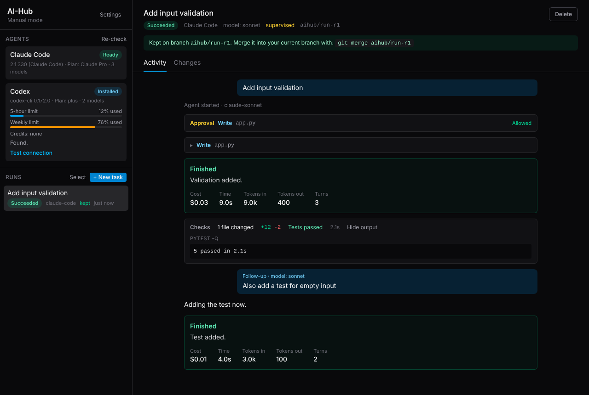
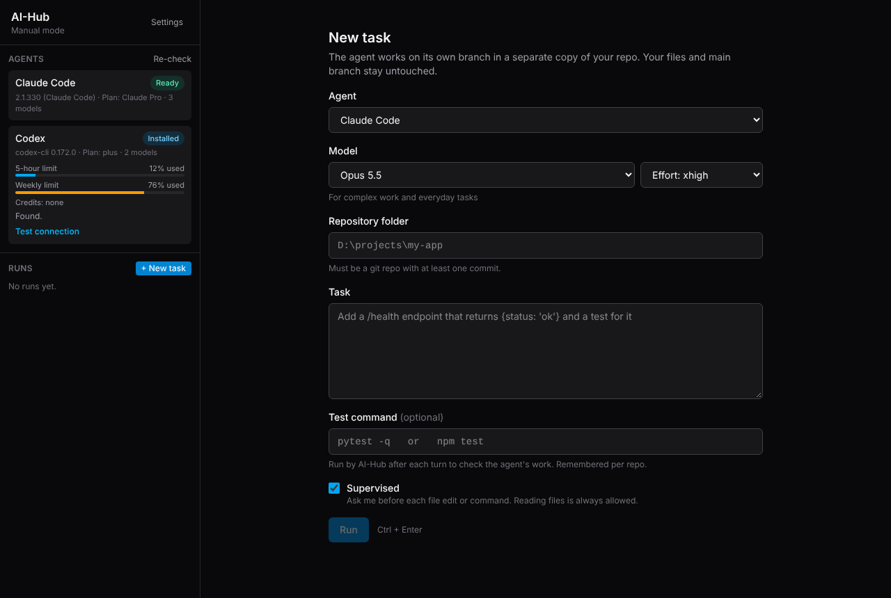
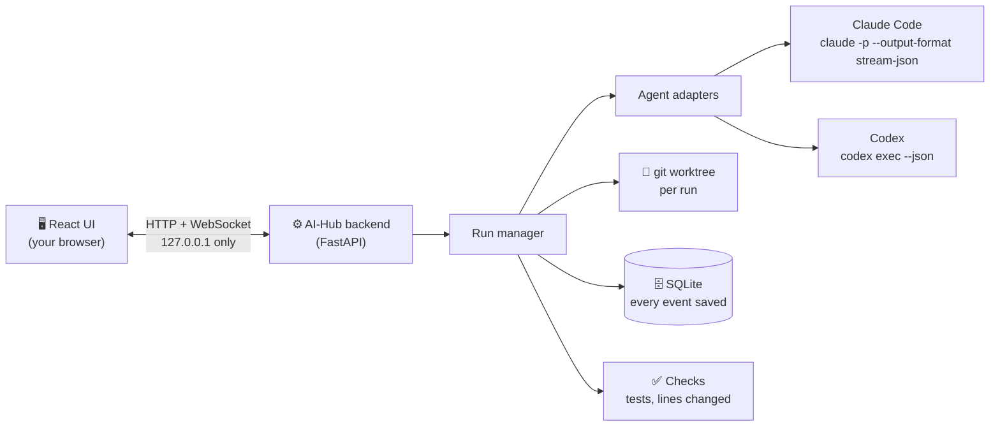
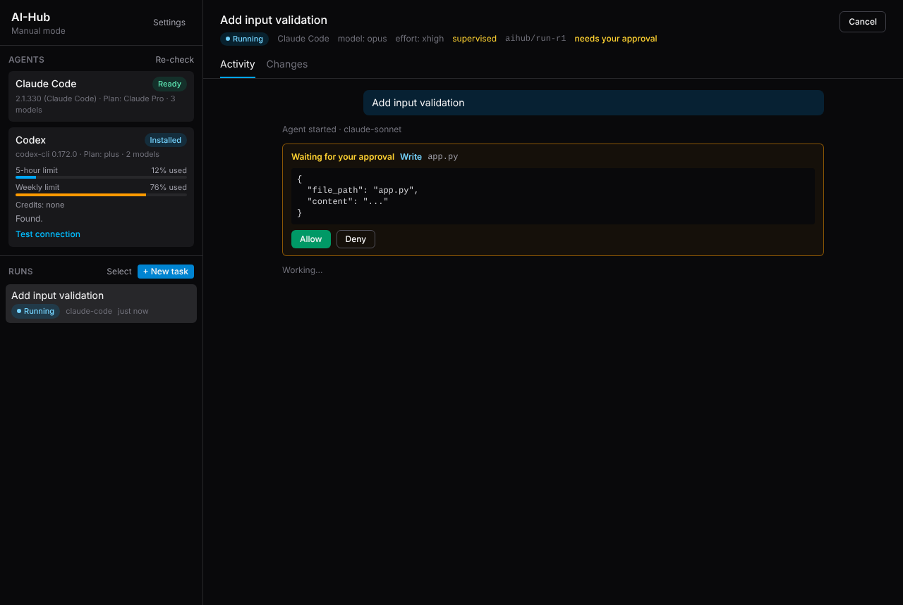
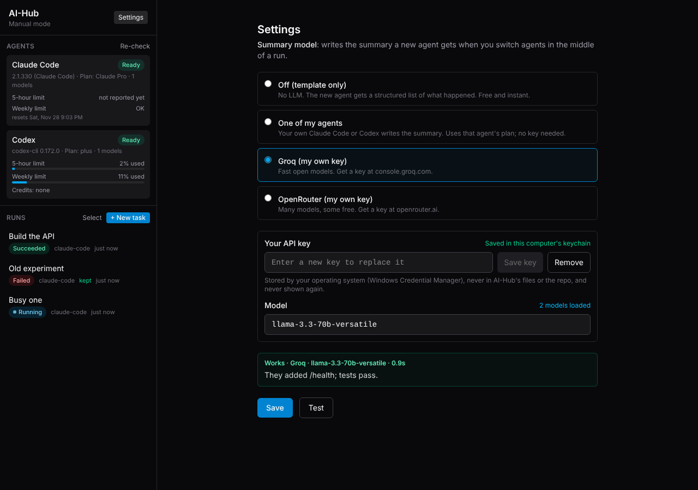

<div align="center">

# 🧠 AI-Hub

### One home for all your AI coding agents, with a brain on top.

Run **Claude Code** and **Codex** from one clean interface, each in its own safe git worktree.
Switch models or even agents mid-task, approve risky steps, and see what every run cost and whether its tests passed.

<p>
  
  
  
  
  
  
</p>

<a href="#-quick-start"><b>Quick start</b></a> ·
<a href="#-features"><b>Features</b></a> ·
<a href="#-how-it-works"><b>How it works</b></a> ·
<a href="#-roadmap"><b>Roadmap</b></a>

<br>



</div>

---

## ✨ Why AI-Hub?

You probably use more than one coding agent. Each is good at different things, and none of them tells you
**which one to use, what it costs, or whether its work actually passes your tests.**

AI-Hub runs the agents **you're already signed in to**, on **your** machine, and measures every run the same way.
It resells nothing and needs no API key. That data is the foundation for the next step: a brain that compares agents,
recommends the right one and splits big tasks across them (see the [roadmap](#-roadmap)).

## 🚀 Features

<table>
<tr>
<td width="50%" valign="top">

### 🤖 Your agents, one place
- **Claude Code** and **Codex**, detected automatically
- Your **real model list** (Opus 5.5, Sonnet 5.5, GPT-6.2-Sol…) with **effort levels**
- **Plan, usage limits and credits**, right in the sidebar
- Models that need credits you don't have are **hidden automatically**

</td>
<td width="50%" valign="top">

### 🛡️ Safe by design
- Every run gets its **own git worktree and branch**; your folder and `main` are never touched
- **Supervised mode**: approve each file edit or command
- **Keep** (commit to the run's branch) or **Discard** with one click
- The server only listens on `127.0.0.1`

</td>
</tr>
<tr>
<td valign="top">

### 🔁 Switch anything, mid-task
- Change **model or effort** on any follow-up
- **Switch agent** (Claude → Codex) in the same run: the new agent gets a **handoff** summary, and you can read exactly what it was told
- Summaries written by a template, **your own agent**, or **your own Groq / OpenRouter key**

</td>
<td valign="top">

### 📊 Every run, measured
- Live activity: messages, tool calls, results
- **Cost, time, tokens** per turn
- After each turn AI-Hub runs **your test command** and counts **lines changed**
- Side-by-side **diff viewer** (VS Code's Monaco)

</td>
</tr>
</table>

<div align="center">


</div>

## ⚡ Quick start

### 1. What you need

| | |
|---|---|
| 🐍 **Python 3.10+** | `python --version` |
| 🟢 **Node.js 20+** | `node --version` |
| 🌿 **git** | `git --version` |
| 🤖 **At least one agent, signed in** | [Claude Code](https://code.claude.com/docs) (`claude auth login`) and/or [Codex CLI](https://github.com/openai/codex) (`codex login`) |

### 2. Install (once)

```bash
git clone https://github.com/vashisthaharshit/AI-hub.git
cd AI-hub

# Backend
cd backend
python -m venv .venv
.venv\Scripts\activate          # Windows (PowerShell: .\.venv\Scripts\Activate.ps1)
# source .venv/bin/activate     # macOS / Linux
pip install -e .

# UI
cd ../frontend
npm install
npm run build
```

### 3. Run

```bash
cd backend
aihub
```

Your browser opens at **http://127.0.0.1:8000**. 🎉

> [!TIP]
> In the **Agents** panel, click **Test connection** on each agent. Then make a throwaway git repo
> (`git init`, add a file, `git commit`) and give your first task a try. Agents never touch your real
> folder anyway: every run works in its own copy.

Options: `aihub --port 8100` · `aihub --no-browser`

## 🔍 How it works



1. **You start a task.** AI-Hub creates a new branch `aihub/run-<id>` in a separate worktree.
2. **The agent runs headless** inside it. Each agent's output is turned into one shared event format.
3. **Every event is saved** (event sourcing) and **streamed live** to the UI.
4. **After each turn**, AI-Hub measures the result itself: files and lines changed, and your test command.
5. **You decide:** follow up, switch model or agent, keep the work, or discard it.

<details>
<summary><b>🔁 What happens when you switch agents?</b></summary>

<br>

A Claude session can't be opened by Codex, so AI-Hub carries over what can be carried:

- **The files**: the new agent works in the same worktree, so every change is already there.
- **The context**: a *handoff* built from AI-Hub's event log: the original task, what each turn did,
  tools used, files touched, test results, the current changes, and then your new message.

The handoff is written by a plain **template** (free, instant) or by a **summary model** you choose in Settings.
If the summary model fails, the template is used, so a switch never gets stuck. You can open
**"What Codex was told"** on any switch to see the exact text.

</details>

<details>
<summary><b>🔐 Where do my API keys go?</b></summary>

<br>

You only need a key for the optional Groq / OpenRouter summary model. It's stored in your **operating system's
keychain** (Windows Credential Manager, macOS Keychain, Linux Secret Service) via [`keyring`](https://pypi.org/project/keyring/),
never in AI-Hub's database, files or this repo, and the UI never shows it again. Each user uses **their own** key.

</details>

<details>
<summary><b>🖼️ More screenshots</b></summary>

<br>

**Supervised mode:** approve or deny each step



**Settings:** pick who writes summaries



</details>

## 🤖 Supported agents

| Agent | Run | Follow-ups | Model + effort | Supervised | Usage shown |
|---|:-:|:-:|:-:|:-:|---|
| **Claude Code** | ✅ | ✅ | ✅ | ✅ | Plan, 5-hour and weekly windows |
| **Codex CLI** | ✅ | ✅ | ✅ | runs in its sandbox | Plan, usage %, credits |
| Antigravity CLI | 🔜 | | | | |

Adding an agent = one adapter file in [`backend/aihub/agents/`](backend/aihub/agents). See [CONTRIBUTING.md](CONTRIBUTING.md).

## 🗺️ Roadmap

- [x] **Phase 1: Manual mode.** Run, watch, review, follow up, switch models and agents, supervised mode, checks
- [ ] **Phase 2: Compare and evaluate.** Same task on 2 agents side by side, LLM judge, a 20–30 task benchmark
- [ ] **Phase 3: Orchestrator.** "Plan my task": AI-Hub splits the work across agents, verifies and merges
- [ ] **Phase 4: Smart router.** Recommends the best agent per task on a cost ↔ quality slider, based on your own results

## 🧑‍💻 Development

```bash
cd backend && pip install -e ".[dev]" && pytest      # backend tests (no tokens used)
cd frontend && npm test && npm run typecheck          # UI tests and type check
cd frontend && npm run dev                            # UI with hot reload on :5173 (run `aihub --no-browser` too)
```

Project structure, design rules and how to add an agent: **[CONTRIBUTING.md](CONTRIBUTING.md)**.

## 🙏 Acknowledgements

Inspired by [T3 Code](https://github.com/pingdotgg/t3code). AI-Hub builds on the same idea (run the agents you
already have) and adds measurement and, next, a brain on top.

## 📄 License

[MIT](LICENSE) © Harshit Vashistha
