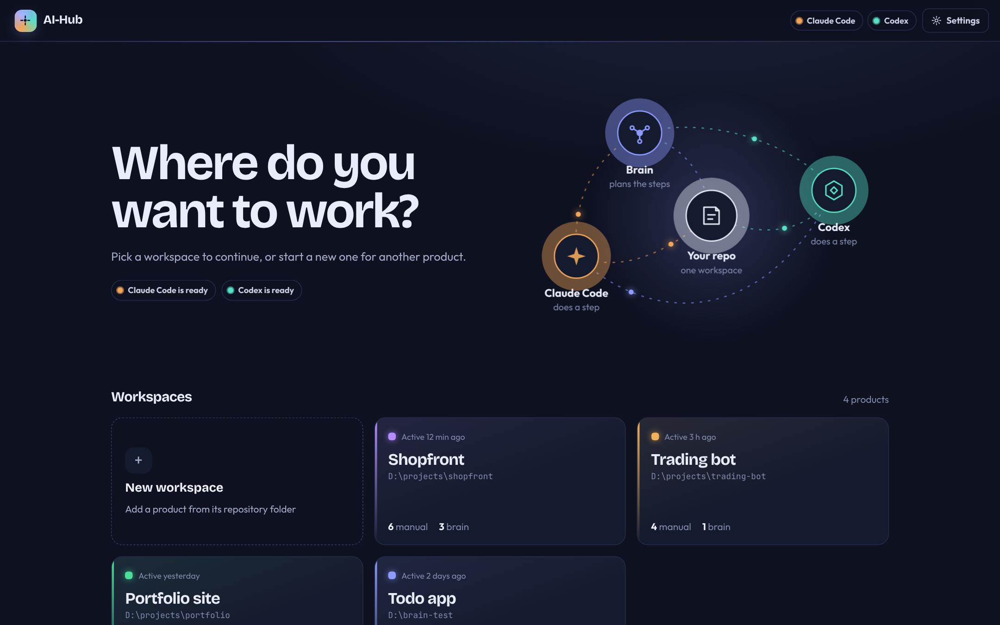
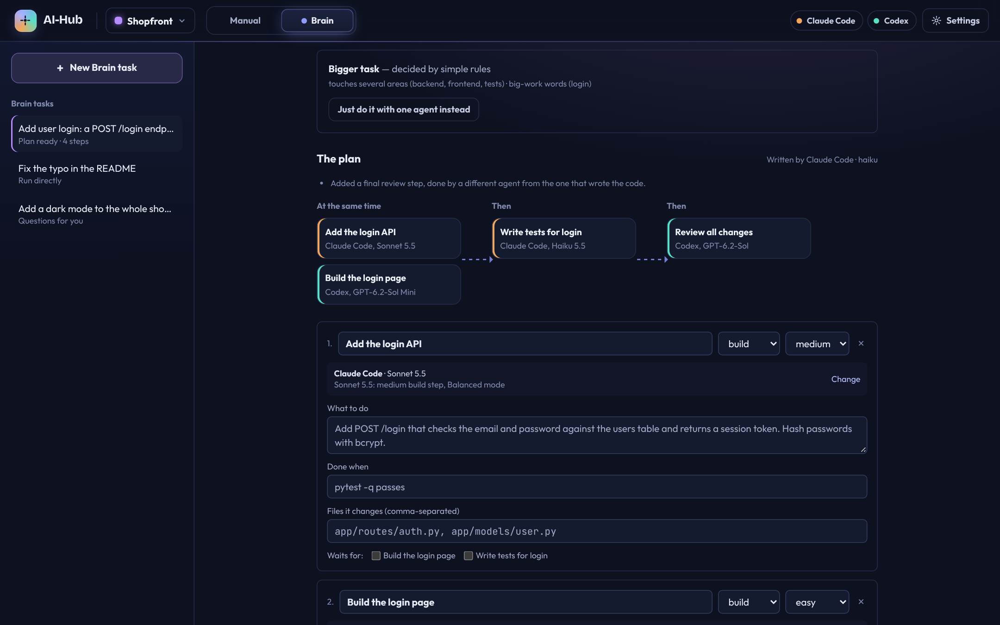
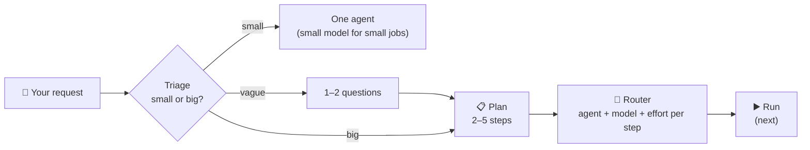
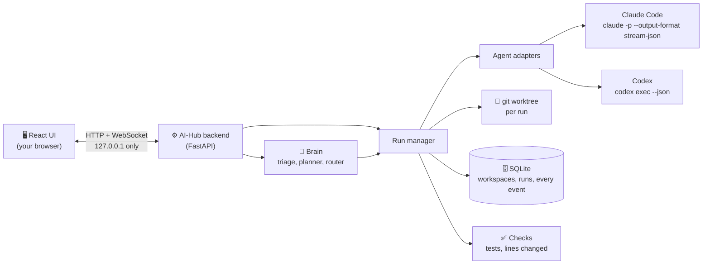
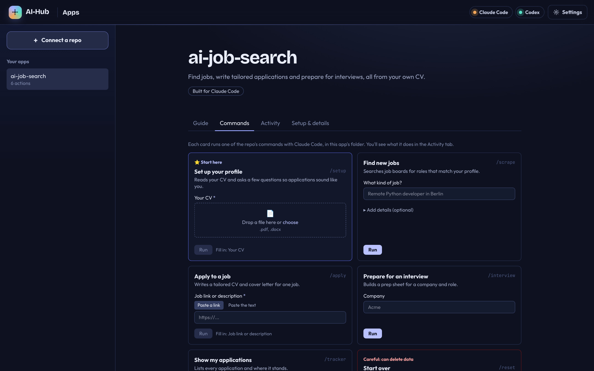
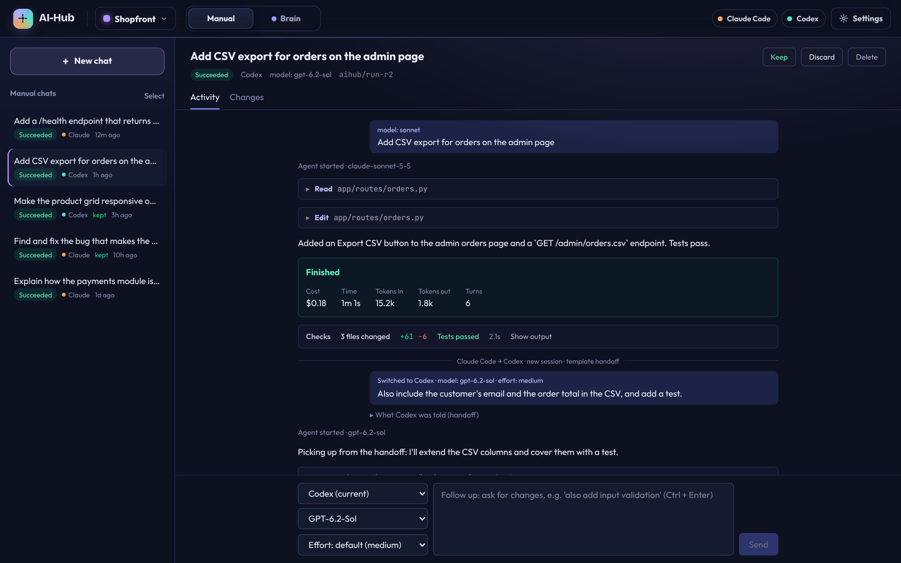

<div align="center">

# 🧠 AI-Hub

### One home for your AI coding agents, with a brain on top.

Run **Claude Code** and **Codex** on your own products from one clean interface.
Chat with one agent yourself, or describe a bigger job and let the **Brain** plan it and pick the right agent and model for every step.

<p>
  
  
  
  
  
  
</p>

<a href="#-quick-start"><b>Quick start</b></a> ·
<a href="#-features"><b>Features</b></a> ·
<a href="#-the-brain"><b>The Brain</b></a> ·
<a href="#-how-it-works"><b>How it works</b></a> ·
<a href="#-roadmap"><b>Roadmap</b></a>

<br>



</div>

---

## ✨ Why AI-Hub?

You probably use more than one coding agent. Each is good at different things, and none of them tells you
**which one to use for a job, what it will cost, or whether its work actually passes your tests.**

AI-Hub runs the agents **you're already signed in to**, on **your** machine. It needs no API key and resells nothing.
On top of that sits the **Brain**: describe what you want, and it decides whether the job is small enough for one
agent or should be split into steps, then picks an agent, model and effort for each step, cheap where that's
enough and strong where it matters.

## 🚀 Features

<table>
<tr>
<td width="50%" valign="top">

### 🗂️ Workspaces
- One **workspace per product** (one repo folder); pick it on the home screen and everything inside works there
- All of a product's chats in one place, **Manual and Brain kept apart**
- Each workspace has its own color and **test command**

</td>
<td width="50%" valign="top">

### 🧠 The Brain
- **Triage first:** small jobs go straight to one agent, so no tokens are spent on planning
- Bigger jobs become a **plan of 2–5 steps**; steps that touch different files can run **at the same time**
- **Asks 1–2 questions** when a request is vague
- Picks an **agent, model and effort for every step** (Cheapest / Balanced / Best), with the reason shown

</td>
</tr>
<tr>
<td valign="top">

### 🤖 Manual mode
- Chat with **Claude Code** or **Codex**, with your **real model list** and **effort levels**
- **Switch model or agent mid-task**; the new agent gets a **handoff** summary
- **Plan, usage limits and credits** for each agent

</td>
<td valign="top">

### 🧩 Apps
- Connect a **GitHub repo made for AI agents** (a job search helper, a trading assistant…) and use it through **buttons and simple forms**
- AI-Hub checks and installs the tools it needs, asks for its keys, and **always asks before money moves**
- **Update** an app with a backup first

</td>
</tr>
<tr>
<td valign="top">

### 🛡️ Safe by design
- Every run gets its **own git worktree and branch**; your folder and `main` are never touched
- **Ask me before each change** (supervised mode)
- **Keep** or **Discard** with one click
- The server only listens on `127.0.0.1`; your keys stay in the **OS keychain**

</td>
<td valign="top">

### 📊 Every run, measured
- Live activity: messages, tool calls, results
- **Cost, time and tokens** per turn
- After each turn AI-Hub runs **your test command** and counts **lines changed**
- Side-by-side **diff viewer** (VS Code's Monaco)

</td>
</tr>
</table>

<div align="center">


</div>

## ⚡ Quick start

### 1. What you need

| | |
|---|---|
| 🐍 **Python 3.10+** | `python --version` |
| 🟢 **Node.js 20+** | `node --version` |
| 🌿 **git** | `git --version` |
| 🤖 **At least one agent, signed in** | [Claude Code](https://code.claude.com/docs) (`claude auth login`) and/or [Codex CLI](https://github.com/openai/codex) (`codex login`) |

### 2. Install (once)

```bash
git clone https://github.com/vashisthaharshit/AI-hub.git
cd AI-hub

# Backend
cd backend
python -m venv .venv
.venv\Scripts\activate          # Windows (PowerShell: .\.venv\Scripts\Activate.ps1)
# source .venv/bin/activate     # macOS / Linux
pip install -e .

# UI
cd ../frontend
npm install
npm run build
```

### 3. Run

```bash
cd backend
aihub
```

Your browser opens at **http://127.0.0.1:8000**. 🎉

### 4. Your first task

1. **Create a workspace:** click **New workspace** and choose your product's Git folder (it needs at least one commit).
2. **Ask for something:**
   - **Manual:** pick an agent, describe the change, click **Start chat**.
   - **Brain:** describe the job. Small jobs run with one agent; bigger ones get a plan you can review and edit.
3. **Review and keep:** agents work on a copy. Check the changes and test results, then click **Keep** or **Discard**.

> [!TIP]
> Want to try it safely? Make a throwaway repo (`git init`, add a file, `git commit -m start`) and use it as your
> first workspace. Your agents' status is in the top bar: click it to test the connection or re-check usage.

Options: `aihub --port 8100` · `aihub --no-browser`

## 🧠 The Brain



- **Triage** uses simple rules first (free and instant). Only when they aren't sure does it ask the cheapest
  model available. When still unsure it runs the job directly: you can always click **Plan it instead**.
- **The planner** is a cheap model that reads a short summary of your repo made by code, not the whole repo.
  AI-Hub then checks the plan itself: steps that run at the same time never touch the same files, every step
  says how to check it worked, and a final **review** step is added for a second pair of eyes.
- **The router** chooses for each step, with the reason shown:

  | | Easy step | Medium step | Hard step |
  |---|---|---|---|
  | **Cheapest** | small model | small model | medium model |
  | **Balanced** (default) | small model | medium model | strong model |
  | **Best** | medium model | strong model | strongest model, high effort |

  It avoids agents that are close to their usage limit, spreads parallel steps across Claude Code and Codex, and
  gives the review to a different agent from the one that wrote the code. You can change any choice.

Runs started by a Brain task stay in Brain; **Move to Manual** brings one over to keep chatting with it there.

## 🔍 How it works



1. **You start a task** in a workspace. AI-Hub creates a branch `aihub/run-<id>` in a separate worktree.
2. **The agent runs headless** inside it. Each agent's output is turned into one shared event format.
3. **Every event is saved** and **streamed live** to the UI.
4. **After each turn**, AI-Hub measures the result itself: files and lines changed, and your test command.
5. **You decide:** follow up, switch model or agent, keep the work, or discard it.

<details>
<summary><b>🔁 What happens when you switch agents?</b></summary>

<br>

A Claude session can't be opened by Codex, so AI-Hub carries over what can be carried:

- **The files**: the new agent works in the same worktree, so every change is already there.
- **The context**: a *handoff* built from AI-Hub's event log: the original task, what each turn did,
  tools used, files touched, test results, the current changes, and then your new message.

The handoff is written by a plain **template** (free, instant) or by a **summary model** you choose in Settings.
If the summary model fails, the template is used, so a switch never gets stuck.

</details>

<details>
<summary><b>💸 Does the Brain cost a lot of tokens?</b></summary>

<br>

No. Small jobs skip planning entirely. A plan is one call to the cheapest model you have (about 2–5k tokens),
and the triage check, when needed, is about 200. If you set a Groq or OpenRouter key as the summary model in
Settings, planning doesn't use your Claude or Codex limits at all.

</details>

<details>
<summary><b>🔐 Where do my API keys go?</b></summary>

<br>

Keys (an optional Groq / OpenRouter key, or an app's keys) are stored in your **operating system's keychain**
(Windows Credential Manager, macOS Keychain, Linux Secret Service) via [`keyring`](https://pypi.org/project/keyring/),
never in AI-Hub's database, files or this repo, and the UI never shows them again. Each user uses **their own** key.

</details>

<details>
<summary><b>🖼️ More screenshots</b></summary>

<br>

**A run:** live activity, cost and tokens, test checks, follow-ups


**Apps:** a GitHub repo used through buttons



**Switching agents** mid-run, with a handoff



</details>

## 🤖 Supported agents

| Agent | Run | Follow-ups | Model + effort | Ask before changes | Usage shown |
|---|:-:|:-:|:-:|:-:|---|
| **Claude Code** | ✅ | ✅ | ✅ | ✅ | Plan, 5-hour and weekly windows |
| **Codex CLI** | ✅ | ✅ | ✅ | runs in its sandbox | Plan, usage %, credits |
| Antigravity CLI | 🔜 | | | | |

Adding an agent = one adapter file in [`backend/aihub/agents/`](backend/aihub/agents). See [CONTRIBUTING.md](CONTRIBUTING.md).

## 🗺️ Roadmap

- [x] **Manual mode.** Run, watch, review, follow up, switch models and agents, ask before changes, checks
- [x] **Apps.** GitHub repos made for agents, used through buttons, with setup, money safety and updates
- [x] **Workspaces and a new interface.** One workspace per product
- [x] **Brain: plan.** Triage, clarifying questions, a checked and editable plan
- [x] **Brain: router.** Agent, model and effort per step (Cheapest / Balanced / Best)
- [ ] **Brain: run the plan.** Steps one after another, with briefs, checks and "approve each step"
- [ ] **Brain: parallel steps.** Separate worktrees, merge, a review step, then Keep or Discard
- [ ] **Brain: step up on failure.** Retry a failed step once with a stronger model
- [ ] **Project memory.** Agents look things up instead of re-exploring the repo, with fewer tokens
- [ ] **Learning from history.** The router learns which choices work for your projects

## 🧑‍💻 Development

```bash
cd backend && pip install -e ".[dev]" && pytest      # backend tests (no tokens used)
cd frontend && npm test && npm run typecheck          # UI tests and type check
cd frontend && npm run dev                            # UI with hot reload on :5173 (run `aihub --no-browser` too)
```

Project structure, design rules and how to add an agent: **[CONTRIBUTING.md](CONTRIBUTING.md)**.

## 🙏 Acknowledgements

Inspired by [T3 Code](https://github.com/pingdotgg/t3code). AI-Hub builds on the same idea (run the agents you
already have) and adds measurement, apps and a brain on top.

## 📄 License

[MIT](LICENSE) © Harshit Vashistha
